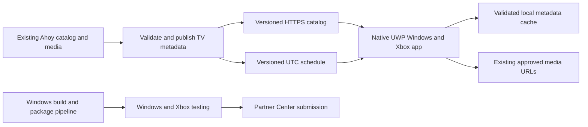

# Ahoy TV — Windows and Xbox implementation plan

Planning date: October 26, 2026. Implementation paused at the owner's request. This is a handoff for a future building agent, not authorization to resume building now.

## 1. Outcome and recommended product decisions

Ship an Ahoy-branded streaming application in the Microsoft Store on Windows and Xbox. The experience should make it easy to open Ahoy, tune into independent culture, browse what is playing next, and choose videos on demand with a controller. Pluto TV is a reference for the channel-and-guide interaction; retain Ahoy's own identity and artwork.

Recommended defaults for the next implementation, subject to owner changes:

- One free scheduled channel, **Ahoy TV**, and a complementary **On Demand** catalog.
- No mandatory sign-in. Local favorites, last channel, and on-demand progress only.
- A channel guide with accurate Now / Next information and a browsable upcoming schedule.
- First launch lands on Watch with a visible Tune In action. Later launches select the last available channel but wait for explicit playback. Returning from suspension also waits for the viewer to resume.
- English UI initially. Target Windows 11 and Xbox Series X/S; add Xbox One to the supported release matrix only after testing on it. Windows 10 compatibility may be tested separately and must not be claimed from a manifest alone.
- No ads, subscriptions, purchases, or background audio in the initial public release. These can be scoped separately after the viewing experience works.
- Progressive HTTPS MP4 delivery initially if the real console playback spike succeeds. No dedicated live encoder is necessary for a schedule assembled from prerecorded videos. Add adaptive HLS/DASH if bandwidth and device testing justify it.
- Describe this as a scheduled channel. Do not imply footage is being captured live. Existing `live` catalog tags describe recorded performances, not a live feed.

These are planning recommendations, not decisions previously approved individually by the owner. Do not add recurring infrastructure spend, purchase hardware, enroll accounts, or publish from this document alone.

## 2. Current repository and verified limits

Workspace: `/Users/agworkywork/Documents/ChatGPT/ahoy-on-xbox`.

| Component | Current evidence |
| --- | --- |
| App | C# / XAML UWP starter with a `MediaPlayerElement` and channel/program lists |
| Package | Universal device-family manifest; development identity; x64 project settings; signing disabled |
| Catalog | Bundled snapshot of 36 available videos from the existing Ahoy platform |
| Queue groups | Mix: 36; music-video tag: 1; skating: 4; G-Dub Disc Golf: 6 |
| Additional grouping material | 15 videos tagged poetry; 4 tagged Wintergreen Sessions; confirm overlaps/editorial intent |
| Duration metadata | 15 missing; the 21 string values have not been checked against media files |
| Media | All 36 snapshot media URLs use `storage.googleapis.com`; availability, codecs, bitrate and seek behavior are untested |
| Art | Provisional development tiles; no approved TV artwork |
| Tests | XML/catalog/image-dimension source checks passed in the prior implementation turn |
| Runtime | No Windows compilation, launch, Xbox deployment, controller test, or verified video playback |
| Distribution | No Git remote configured; no CI run, signed package, Partner Center product, or submission |

Original metadata source is `/Users/agworkywork/ahoy-little-platform/static/data/videos.json`. Preserve existing IDs, titles, descriptions, hosts, and URLs. Do not assume the separate source checkout's local state is the latest deployed catalog. Check its Git status and fetch before proposing changes there; protect unrelated work.

No Windows build tools or connected Windows machine were identified in this chat. The owner answered “no” to the combined environment/account question, then requested planning only. Treat Windows access, GitHub destination, Xbox test access, and Partner Center ownership as unresolved prerequisites; do not invent them.

## 3. Delivery architecture

Use native C# / XAML UWP as the initial route because Xbox is a primary target and a starter exists. Do not replace it with a Windows-only WinUI 3, Electron, or PWA package without proving Xbox compatibility and agreeing on the scope change. WebView2 is an alternative only if the native playback spike fails or the reuse benefit warrants a separate evaluation.

Split responsibilities before the app grows:

- `Models`: catalog, channel, schedule, playback mode, saved progress.
- `CatalogService`: HTTPS fetch, schema validation, cache, bundled fallback.
- `ScheduleService`: validated UTC timeline, current slot lookup, offset calculation, refresh and expiry.
- `PlaybackService`: one media player, source lifecycle, tune/seek/play, failure recovery, metadata, stale-event protection.
- `LocalStateService`: stable IDs, favorites, last channel and VOD positions.
- View models and views: Watch, Guide, On Demand, Details, Settings/Help.

Keep pure scheduling and state logic independent of XAML so it can be tested without an Xbox. Keep the main Ahoy platform a separate app. TV metadata should be an additive publishing surface rather than a reason to rewrite existing web playback.

## 4. Screens and controller behavior

| Screen | Required behavior |
| --- | --- |
| Watch | Main player, channel name, accurate program title, progress, Now / Next, Guide and Browse actions |
| Guide | Channel rows and upcoming time blocks; current position marker; select current slot to tune; future slot shows details without pretending to play future television |
| On Demand | Collections based on approved catalog tags/series; All Videos fallback; local title/host search using Windows text input |
| Details | Original title, host, description, measured duration, artwork, captions availability; Play from beginning / Resume for VOD |
| Settings / Help | App version, accessibility options, local-data reset, real privacy/support destinations and connection status |

Use Ahoy typography, colors, and existing approved brand assets. Work from a 1080p TV composition with responsive scaling; specify device-independent dimensions rather than assuming physical pixels equal XAML units. Keep the video dominant, text readable from a couch, focus highly visible, and guide rows uncluttered.

Input contract:

- D-pad / left stick moves focus; A activates the focused item.
- B closes overlays or exits fullscreen, then returns to the previous screen. At the top level, leave system back behavior available.
- Standard media controls support pause/play and VOD seeking; no mandatory keyboard or mouse.
- Optional shoulder-button channel changes can follow the core controller pass; they are not required to discover a channel.
- Preserve focus when returning from overlays and collection/detail screens; scroll focused programs into view.
- Use Xbox directional focus mode rather than relying on default mouse emulation. Test actual controller behavior, not just XAML properties.
- Windows mouse, keyboard, resizing, and Narrator remain functional.

## 5. Catalog and scheduling contract

Proposed public metadata resources, paths to be finalized on the real Ahoy-controlled host:

- `/tv/v1/catalog.json`
- `/tv/v1/schedule.json`

These are proposed paths, not deployed endpoints. The implementation must configure and verify the actual origin. An initial packaged catalog supports development, but remote editorial updates must not require a Store app release.

Catalog contract:

- `schemaVersion`, `revision`, `publishedAtUtc`.
- Videos: existing stable `id`, exact `title`, `host`, `description`, HTTPS `mediaUrl`, absolute `thumbnailUrl`, measured positive `durationSeconds`, source media revision, ordered tags/series, and optional caption tracks with language/format.
- Channels: stable `id`, display name, display order, artwork, and approved asset membership/programming rules.
- Publish only rights-cleared assets for configured territories. Keep clearance records and owner contact information private; a public `approved` flag is not the evidence record.
- Resolve existing relative artwork against the verified real Ahoy origin; preserve media URLs unless remediation is authorized.
- Reject duplicate IDs, invalid URLs, unsupported schema versions, invalid durations, or references to missing videos.

Schedule contract:

- `schemaVersion`, `revision`, `catalogRevision`, `generatedAtUtc`, `validFromUtc`, `validUntilUtc`.
- Slots: stable `id`, `channelId`, `videoId`, `startUtc`, `endUtc`.
- UTC half-open intervals: `startUtc <= now < endUtc`. Display times in the viewer's locale.
- Measured asset duration defines slot length. Never substitute guessed durations to fill a guide.
- Publish seven days ahead and regenerate daily using a small deterministic publishing script. Choose run location after hosting access is known; do not create a new service subscription just for a JSON feed.
- Validate every advertised channel for gaps, overlaps, duplicate slot IDs, missing assets, territory restrictions, and duration mismatch before publishing.
- Publish matching catalog/schedule revisions atomically or publish catalog first and keep old catalog revisions retrievable during a transition. The app must not activate a schedule whose referenced catalog is unavailable.
- Cache responses with ETag/conditional requests. Keep the last validated pair; do not replace it with a partial or invalid response.

Start with Ahoy TV as the only scheduled channel. Poetry, Wintergreen Sessions, Tallboyz/Skating, and G-Dub can be on-demand collections first. Launch a dedicated channel only after measured runtime and editorial review support an acceptable rotation. The current one-item music-video category should not become a standalone channel by default.

### Tune-in and time behavior

1. Resolve authoritative UTC using the metadata response's server time/HTTP Date with round-trip uncertainty; compare against device UTC. Surface significant clock uncertainty and avoid repeated seek correction loops.
2. Locate the current valid slot and load its media using a new playback session token.
3. On open, seek to `nowUtc - startUtc` within the actual seekable range, then play. Do not seek before the media is ready.
4. Use current UTC to resolve each next program boundary. Avoid chaining only from `MediaEnded`, which accumulates drift or can advance early on failures.
5. Only current-session events may update UI or advance playback. Disposed or superseded sources must not affect the new channel.
6. Initial synchronization target: within five seconds of the scheduled position after buffering under normal test conditions. If outside tolerance, correct once when stable; do not continuously interrupt playback.
7. Pausing the scheduled channel freezes the viewer's video. Resume explicitly returns to the current scheduled point; label this action “Return to channel.” Full DVR/catch-up is outside initial scope.
8. VOD supports normal seek and resume independently. A visible Back to channel action returns to the current schedule rather than the earlier VOD position.
9. Expired or unavailable schedule: show that the guide is unavailable and offer On Demand. A local continuous queue may be offered as a clearly labeled mix, never shown as a current scheduled broadcast.
10. Failed scheduled asset: show an honest unavailable state and a retry/On Demand action. Do not silently play unrelated content while displaying the failed program's title. Recover at the next valid slot if the viewer remains tuned.

## 6. Playback reliability, lifecycle and privacy

- Use one `MediaPlayer` and native transport controls. Add `MediaPlaybackItem` display metadata so system controls show the correct title; verify default media-command integration.
- Fix the starter's page lifecycle: it currently creates a readonly player in the constructor and disposes it on `Unloaded`. Ensure a reload cannot reuse a disposed player or attach duplicate handlers.
- Pause on app suspension/background transition for this foreground-video release. Save last channel and VOD position before termination where possible; never autoplay unexpectedly on return.
- Save VOD progress periodically and on pause/suspend; ignore completion positions and clamp restoration to the actual duration.
- Separate load/buffering, paused, playing, failure, and offline states. Provide Retry with a bounded policy; cancel retries on channel changes, back/navigation, and shutdown.
- Release player sources, media items, event subscriptions, timers and outstanding requests when replaced or unloaded.
- Keep the display awake while video is actively playing and release the display request when paused, failed, suspended or stopped.
- Support provided caption tracks and system accessibility behavior. Do not advertise captions when no track exists.
- Use HTTPS, a configured allowed media/metadata origin policy, finite request timeouts and metadata size limits. Do not introduce arbitrary remote code or HTML rendering from metadata.
- No account tokens or publisher credentials in public JSON or the app package. No analytics SDK by default; make any later telemetry decision explicit, minimal, and reflected in the privacy disclosure.

## 7. Build phases and deliverables

| Phase | Work | Exit evidence |
| --- | --- | --- |
| 0 — Validate route | Identify owner account/Store eligibility, Windows build location, repository destination, Xbox hardware/tester; run a minimal native playback spike | Debug x64 compiles and plays one real Ahoy video on Windows; an actual console playback check before major UI investment |
| 1 — Stabilize starter | Fix project/toolchain issues, directional focus, back handling, media lifecycle, errors, system metadata, suspend/resume | Controller-only browse/play/fullscreen/back works on Xbox; no disposed-player or stale-event failures |
| 2 — Prepare TV data | Audit all 36 sources, measure durations/codecs, resolve art, identify clearance/territories, publish versioned catalog and scheduling script | Machine-readable audit report, approved launch subset, validated schedule with no gaps/overlaps |
| 3 — Build viewer product | Watch, Guide, On Demand, Details, search, favorites/progress; scheduled tune-in and boundary behavior | Two clients tune into the same scheduled position within agreed tolerance; VOD and scheduled modes behave distinctly |
| 4 — Operationalize | Windows CI, reproducible packages, metadata caching/rollback, local diagnostics and documentation | Clean-checkout Debug and Release build logs; downloadable test package; successful metadata update and rollback exercise |
| 5 — Qualify and submit | Device soak/accessibility tests, Store art/listing/privacy/ratings, identity association, certification tooling and review package | Signed/Store-associated artifacts as required, test evidence, listing preview, owner review before publication |

Do not start with a week of UI work on this Mac while the target build path remains unproven. Once work resumes, Phase 0 is the first task. Without Windows, an agent can prepare code and tests but cannot honestly close the compile/package milestones.

### Windows build route

Preferred: Windows 11 build machine with Visual Studio UWP C# tooling, a supported Windows SDK, NuGet restore and .NET Native tooling where required by Release. The starter currently targets SDK 10.0.19041.0; verify/install this SDK or deliberately move to an available supported version and test compatibility.

Alternative: a GitHub Actions Windows runner can provide compilation and downloadable artifacts after the owner supplies/authorizes a repository. Use a specific Windows runner image and verify its installed SDK/UWP components; do not assume `windows-latest` will always contain the necessary toolchain. Cloud CI does not replace an actual console test. Another agent using this same Mac has the same Windows limitation.

Build automation should:

- Restore, build Debug x64 and Release x64, fail on nonzero exit, and retain useful logs.
- Run pure domain tests and metadata validation.
- Produce an explicitly labeled development sideload package when requested, with the required dependencies and public certificate instructions.
- Keep temporary development certificates/private keys out of Git and uploaded artifacts. Any release identity and signing credentials belong in approved secret storage.
- Separate development packages from Store upload artifacts. Document exact install and uninstall steps.
- Add manual release dispatch only after identity/account setup. Normal push/PR workflows must not publish to Partner Center.

## 8. Verification and acceptance criteria

### Automated tests that matter

- Schedule: exact boundaries, UTC/local conversion including DST, unknown channels/videos, gaps/overlaps, zero/negative durations, expiry, incompatible revisions and clock offset.
- Catalog: invalid schemas/URLs, duplicates, missing artwork/caption data, timeout, invalid response, valid cached fallback and atomic replacement.
- Playback/state: rapid channel changes ignore stale callbacks; pause/suspend cancels advancement; current slot recomputes after resume; VOD progress restores to the correct stable video ID.
- Publisher: invalid metadata cannot overwrite the last valid published pair; rollback is reproducible.

### Manual/device pass

- Windows 11 plus Xbox Series X or S. Add Xbox One testing before claiming it as supported.
- Entire app navigable with a controller; visible focus; no traps; B/back consistent; overlays restore prior focus.
- Keyboard/mouse and Narrator names/order tested on Windows; captions tested with real caption fixtures/tracks.
- 720p/1080p/4K output scaling and TV safe area inspected. This is output-layout coverage, not a promise of 4K source video.
- Actual MP4 codecs, HTTP range seeking, seek accuracy, file length, audio levels and thumbnails verified for the approved launch subset.
- Network loss during playback and tune-in; slow bandwidth; expired schedule; app suspend, terminate and relaunch.
- A two-hour continuous viewing test with multiple program boundaries and repeated channel changes; record memory observations and any buffering/crashes.
- Proposed product performance targets: shell usable within five seconds on the tested hardware; first frame within eight seconds on a documented connection adequate for the asset bitrate. Record real results and exceptions rather than treating these as certification rules.
- Correct system media title and transport behavior; display sleep behavior while playing/paused.
- Windows App Certification Kit plus the actual Partner Center validation/certification outcome, recorded separately.

Definition of release-ready: the above evidence exists for the declared support matrix, no release-blocking defects remain, the approved catalog is usable end to end, and the product/listing/package are ready for owner review. A passing Python source check alone is not release readiness.

## 9. Store path and owner-supplied inputs

Microsoft documents publishing UWP **apps** through Partner Center and additional Xbox review. The Xbox app route is distinct from game onboarding; do not route this streaming product through ID@Xbox merely because the target device is an Xbox. Xbox availability must be configured and verified in the actual submission; a Windows Store listing is not sufficient evidence of console distribution.

Required release inputs:

1. Owner-controlled Partner Center Windows/Xbox developer account, publisher identity, reserved Ahoy product name and access via appropriate roles.
2. Windows build access or authorized cloud repository/runner, and an Xbox console with a tester for developer-mode validation.
3. Approved app logo, tiles, channel art and real device screenshots.
4. Owner-confirmed streaming permissions, launch territories, content rating answers and a cleared video subset.
5. Real privacy URL, support URL/email and publisher contact details.
6. Final launch scope decision: scheduled Ahoy TV plus On Demand is the recommendation. A queue-only early release must describe itself accurately.

Submission sequence: associate the project with the real product; set version/identity; build and validate the Store upload artifact; prepare listings/screenshots/ratings; select intended Windows and Xbox device availability; provide certification notes; review everything with the owner; submit when authorized; address certification findings; verify retail installation after approval. Keep Dev Mode sideload proof separate from a retail Store acquisition test.

No store fees or timeline guarantees are assumed. Confirm current account terms and available options in Partner Center. Do not create a public listing from placeholder privacy/support URLs.

## 10. Cost and operations planning

Reuse current Ahoy media storage first. Estimate delivery costs from measured bitrate and expected viewer hours before committing to adaptive transcoding or a streaming provider.

Example planning arithmetic, not a supplier price: 4 Mb/s is approximately 1.8 decimal GB per viewer-hour before overhead; 100 simultaneous viewers for one hour is about 180 GB. Real cost depends on the storage account's region, egress, caching and contract. Measure the actual files; some existing source assets may be too large for comfortable TV startup.

A static versioned catalog/schedule is sufficient for the first programmed channel. Track metadata/feed health and media failures, retain the last known-good revision, and document how to remove an unavailable asset without shipping a new app. For already published slots, replace programming by an explicit revised schedule; do not mutate media behind an unchanged revision without considering cached clients.

Future work after a stable release: adaptive renditions, additional curated channels, accounts/cross-device favorites, editorial scheduling UI, captions expansion, content analytics, sponsorship/ads, and other television platforms. Each changes operating cost or product scope and should have its own acceptance criteria.

## 11. First instruction for the next building agent

> Continue the Ahoy Windows/Xbox project in `/Users/agworkywork/Documents/ChatGPT/ahoy-on-xbox`. Read `docs/BUILD-PLAN.md`, `README.md`, `docs/STORE-RELEASE.md`, and applicable AGENTS.md instructions first. Treat the current app as an uncompiled starter. Begin with Phase 0: establish a real Windows build and Xbox test path, compile the existing x64 UWP project, and prove one Ahoy video plays before expanding the UI. Preserve original Ahoy metadata and unrelated work. Implement the recommended scheduled Ahoy TV + On Demand product in the documented phases, with honest evidence at each exit. If the owner changes launch scope, update the plan. Do not claim Store readiness from source checks; keep compilation, device playback, packaging, submission and retail availability distinct. Prepare a reviewable package/listing before asking for release approval. Do not buy infrastructure, create accounts, or publish without the owner's authorization.

## 12. Official references checked for this plan

- [Xbox UWP app publishing FAQ](https://learn.microsoft.com/en-us/windows/uwp/xbox-apps/frequently-asked-questions) — apps can be published through Partner Center with additional Xbox review; x86 submissions are unsupported. Some game-related text on this page is inconsistent with its newer warning; this plan relies only on app guidance.
- [Store package upload and device-family availability](https://learn.microsoft.com/en-us/windows/apps/publish/publish-your-app/msix/upload-app-packages) — Windows.Universal packages do not automatically establish Xbox availability; validate actual targeting in submission.
- [Xbox supported technologies](https://learn.microsoft.com/en-us/windows/uwp/apps-for-xbox/supported-technologies) — target technology compatibility.
- [UWP directional/mouse-mode API](https://learn.microsoft.com/en-us/uwp/api/windows.ui.xaml.application.requirespointermode) — Xbox pointer emulation must be considered explicitly.
- [System media transport integration](https://learn.microsoft.com/en-us/windows/apps/develop/media-playback/integrate-with-systemmediatransportcontrols) — MediaPlayer's automatic transport integration and playback metadata.
- [Windows hosted runner software inventory](https://github.com/actions/runner-images/blob/main/images/windows/Windows2022-Readme.md) — verify installed UWP/SDK components when configuring CI.

Recheck live platform requirements when implementation and submission resume.
