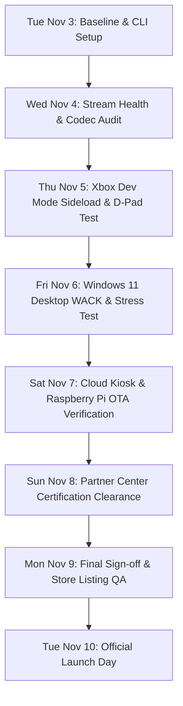

# Ahoy TV — Production Handoff & Launch Playbook (Target: Tuesday, Nov 10, 2026)

**Document Version:** 1.1 (Updated with v0.2.0 release artifacts, LB/RB channel controls, & Duration display)  
**Current Date:** Tuesday, November 3, 2026  
**Target Launch Date:** Tuesday, November 10, 2026 (7-day delivery sprint)  
**Primary Repository:** [github.com/oooAHOYooo/ahoy-on-xbox](https://github.com/oooAHOYooo/ahoy-on-xbox)  
**Main Targets:** Microsoft Store (Windows 10/11 & Xbox Series X/S / Xbox One) + Web/Raspberry Pi OTA Kiosks

---

## Direct Instructions for the Next Agent

If you are picking up this session:
1. **Repository state is on `main`**: All code, catalog updates, and docs are committed and pushed to `origin main`.
2. **Current release packages**: Compiled `v0.2.0` packages are located in `dist/release_packages/v0.2.0/` (built via GitHub Actions CI run `41671270898`):
   - Store submission upload package: `dist/release_packages/v0.2.0/AHOY-TV-StoreUpload-Package/AhoyXbox_0.2.0.0_x64_bundle.msixupload`
   - Xbox console sideload bundle: `dist/release_packages/v0.2.0/AHOY-TV-StoreUpload-Package/AhoyXbox_0.2.0.0_Test/AhoyXbox_0.2.0.0_x64.msixbundle`
   - Web Kiosk package: `dist/release_packages/AhoyTV_Web_Kiosk_v0.2.0.zip`
3. **Microsoft CLI connection**: The user indicated they will hook up Microsoft credentials later today. Once they provide the Azure AD / Partner Center credentials, run:
   ```bash
   msstore reconfigure --tenantId <TENANT_ID> --sellerId <SELLER_ID> --clientId <CLIENT_ID> --clientSecret <CLIENT_SECRET>
   ```
   Then check submission status:
   ```bash
   msstore submission status --appId 9N6QB77PD6RT
   ```
4. **Validation check**: Always run `python3 scripts/validate.py` before committing any XAML, manifest, or catalog edits.
5. **Rebuilding frontend**: If catalog or channels change, execute `python3 scripts/build_unified_frontend.py` to regenerate `AhoyXbox/Web/index.html` and `dist/store_assets/tv_app_preview.html`.

---

## 1. Executive Summary

Ahoy TV is a native, controller-driven big-screen media application and synchronized web kiosk bringing curated independent culture, music, skate tapes, and live sessions directly to television screens.

- **Store Product Identity:** `AHOY TV` (`AhoyIndieMedia.AHOYTV`)
- **Store Product ID:** `9N6QB77PD6RT`
- **Store URL:** [apps.microsoft.com/detail/9N6QB77PD6RT](https://apps.microsoft.com/detail/9N6QB77PD6RT)
- **Store Protocol:** `ms-windows-store://pdp/?productid=9N6QB77PD6RT`
- **Store Family Name (PFN):** `AhoyIndieMedia.AHOYTV_ga5cs1wvjrpmc`
- **Store Package Version:** `0.2.0.0` (aligned with `v0.2.0-alpha.1` release line).
- **Current Store Submission:** Submission 1 (`0.1.0.0`) **Successfully approved & processed for publication on Nov 3, 2026**! Replicating across global Store CDNs (live within 2 hours). Update package `0.2.0.0` is compiled, validated, and ready for update submission.
- **Core Aesthetic:** Obsidian deep glass UI, authentic lower-third EPG dock, restrained Ahoy `#FF0060` highlight color, and watermarked video playback.

---

## 2. Architecture & Components

```
┌────────────────────────────────────────────────────────────────────────┐
│                          Ahoy TV Media Core                            │
│  (36 Catalog Videos + 22 Music Tracks + 4 Curated Linear Channels)      │
└───────────────────────────────────┬────────────────────────────────────┘
                                    │
         ┌──────────────────────────┴──────────────────────────┐
         ▼                                                     ▼
┌─────────────────────────────────┐           ┌─────────────────────────────────┐
│     Native UWP (Xbox/Win)       │           │     Web / Pi OTA Kiosk Engine   │
│  - C# / XAML App                │           │  - Pure JS/HTML5 Video Engine   │
│  - Windows.Media.Playback       │           │  - Apple TV Lower-Third Dock    │
│  - Xbox Controller / D-Pad Nav  │           │  - Polling OTA Cloud Updates    │
│  - Local Settings & Saved Store │           │  - Runs on Pi 4, Kiosk, Browser │
└─────────────────────────────────┘           └─────────────────────────────────┘
```

### A. Native UWP Client (`AhoyXbox/`)
- **Runtime:** Universal Windows Platform (Min version `10.0.17763.0`, Target version `10.0.19041.0`).
- **Core Controller Mapping:**
  - `D-Pad / Left Stick`: Directional focus between Channel List and Schedule EPG.
  - `LB / RB` (`GamepadLeftShoulder` / `GamepadRightShoulder`): Instant previous / next channel hopping.
  - `A Button`: Select channel / start immediate playback.
  - `X Button` (`GamepadX`): Instant Save / Bookmark toggle into the Saved Library.
  - `Y Button` (`GamepadY`): Fullscreen toggle (`IsFullWindow`).
  - `B Button` (`GamepadB`): Dismiss fullscreen or return to primary focus.
- **Catalog Lifecycle:**
  1. Attempts live HTTPS sync with `raw.githubusercontent.com/.../Data/catalog.json`.
  2. Falls back seamlessly to bundled `ms-appx:///Data/catalog.json` if offline.
  3. Merges local radio tracks from `ms-appx:///Data/music.json`.

### B. Curated Linear Channels
| Channel # | Channel Name | Theme / Content | Default Source |
| :---: | :--- | :--- | :--- |
| **101** | **Live Shows** | Wintergreen Sessions & Concerts | `category: "live show"` / `tags: ["wintergreen-sessions", "live"]` |
| **102** | **Music Videos** | Premieres & Soundscapes | `tags: ["music-video", "music"]` + radio catalog tracks |
| **103** | **Films** | Skate Tapes & Documentaries | `category: "film"`, `tags: ["skating", "short-film"]` |
| **104** | **Misc** | 24/7 Mix & Complete Curations | Full 36-video catalog in continuous round-robin loop |

### C. Web / Raspberry Pi Thin Client (`AhoyXbox/Web/index.html`)
- Eliminates SD-card flashing.
- Cloud endpoint deployed to `https://app.ahoy.ooo/tv` (or Pages).
- Thin-client Chromium auto-starts in kiosk mode on Pi 4 with GPU acceleration flags enabled.
- Auto-reloads on git commit updates without breaking current video playback.

---

## 3. Microsoft CLI & Tooling Guide

### A. Microsoft Store Developer CLI (`msstore`)
The `msstore` CLI is installed on this Mac at `/opt/homebrew/bin/msstore`.

#### 1. Setup & Authentication
To configure `msstore`, generate Azure Active Directory credentials within Microsoft Partner Center:
1. Log in to [Partner Center](https://partner.microsoft.com/dashboard).
2. Go to **Settings** (Gear icon) &rarr; **Account Settings** &rarr; **User management** &rarr; **Azure AD applications**.
3. Associate an Azure AD app (or create a new one) with **Manager** permissions.
4. Retrieve the **Tenant ID**, **Client ID**, and generate a **Client Secret**.
5. Find your **Seller ID** under **Account Settings** &rarr; **Organization profile** &rarr; **Legal info**.
6. Run the configuration command:
   ```bash
   msstore reconfigure \
     --tenantId "YOUR_AZURE_TENANT_ID" \
     --sellerId "YOUR_SELLER_ID" \
     --clientId "YOUR_AAD_CLIENT_ID" \
     --clientSecret "YOUR_CLIENT_SECRET"
   ```

#### 2. Everyday Commands
- **Verify Configuration:**
  ```bash
  msstore info
  ```
- **List Registered Applications:**
  ```bash
  msstore apps list
  ```
- **Check Store Submission Status:**
  ```bash
  msstore submission status --appId 9N6QB77PD6RT
  ```
- **Publish Updated Package:**
  ```bash
  msstore publish dist/release_packages/AhoyXbox_0.1.0.0_x64_bundle.msixupload
  ```

---

### B. Xbox Device Portal (Console Remote Control & Sideloading)
For deploying and testing builds on physical Xbox consoles (Xbox One / Xbox Series X/S):

1. **Activate Developer Mode** on the target console via the **Xbox Dev Mode** companion app.
2. In the Dev Home screen, locate the **Remote Access** IP address (e.g., `https://192.168.1.50:11443`).
3. Set your console credentials (username/password) in Dev Home settings.
4. **Deploy from Mac via Web Browser**:
   - Open `https://<xbox-ip>:11443` in Safari/Chrome.
   - Click **Add** under **Installed Apps**.
   - Drag and drop `dist/release_packages/AhoyXbox_0.1.0.0_x64.msixbundle` (or the folder from `dist/release_packages/AhoyXbox_0.1.0.0_Test/`).
   - Add the development certificate if prompted.
5. **Test Gameplay & Controller**:
   - Use physical Xbox Wireless Controller. Verify navigation, D-pad wrapping, trigger responses, and standby behavior.

---

### C. Azure CLI (`az`)
If infrastructure automation or cloud video transcoding is needed:
```bash
brew install azure-cli
az login
```

---

## 4. Current Build & Asset Manifest

All distribution packages have been compiled and verified by CI:

| File / Folder Path | Type | Purpose |
| :--- | :--- | :--- |
| `dist/release_packages/AhoyXbox_0.1.0.0_x64_bundle.msixupload` | Binary (10.1 MB) | Official Microsoft Store upload package (includes crash symbols). |
| `dist/release_packages/AhoyXbox_0.1.0.0_x64.msixbundle` | Binary (516 KB) | Direct sideload bundle for Xbox Dev Mode and Windows 10/11 testing. |
| `dist/release_packages/AhoyXbox_0.1.0.0_Debug_x64.zip` | Archive (69 KB) | Unpackaged debug build for local diagnostics. |
| `dist/release_packages/AhoyTV_Web_Kiosk_v0.1.0.zip` | Archive (430 KB) | Web kiosk bundle ready for static cloud hosting. |
| `dist/store_assets/` | Artwork Directory | 1920x1080 hero art, 1024x1024 icons, box art, poster art, promo squares. |

---

## 5. Day-by-Day Launch Sprint Plan (Nov 3 – Nov 10, 2026)



### Day 1: Tuesday, November 3 (Today)
- [x] Run `git fetch && git pull` to align on `main`.
- [x] Audit CLI installations (`msstore` verified at `/opt/homebrew/bin/msstore`).
- [ ] Log in to Partner Center and verify the exact status of Submission 1 (`9N6QB77PD6RT`).
- [ ] Connect `msstore` CLI via `msstore reconfigure`.

### Day 2: Wednesday, November 4 (Stream Health & Codec Audit)
- [ ] Execute automated stream validation against all 36 video URLs in `AhoyXbox/Data/catalog.json`:
  - Check HTTP status codes (must return `200 OK` or `206 Partial Content`).
  - Check `Content-Type` (`video/mp4`).
  - Verify range-request support (`Accept-Ranges: bytes`) for seeking on Xbox.
- [ ] Validate audio tracks in `AhoyXbox/Data/music.json`.
- [ ] Flag any expiring or geo-restricted Google Cloud Storage tokens.

### Day 3: Thursday, November 5 (Xbox Dev Mode Hardware Test)
- [ ] Sideload `AhoyXbox_0.1.0.0_x64.msixbundle` onto an Xbox One or Xbox Series X/S console via Device Portal.
- [ ] Test controller ergonomics:
  - D-pad and left analog stick navigation between channels and EPG slots.
  - Video auto-play on initial launch (Channel 101).
  - Rapid channel surfing (does playback switch without hanging?).
  - Bookmark feature: pressing `[X]` saves item to local state; restarting app preserves saved items.
  - Fullscreen toggle: pressing `[Y]` and `[B]`.
- [ ] Verify TV Safe Margins (no critical text cut off by overscan on older TV sets).

### Day 4: Friday, November 6 (Windows 11 Desktop & Endurance Testing)
- [ ] Install package on a clean Windows 11 Desktop PC.
- [ ] Run 2-hour continuous playback endurance test (monitor RAM usage to ensure `MediaPlayer` cleans up between queue advancements).
- [ ] Test network disconnect recovery: pull Ethernet/Wi-Fi during playback; confirm app displays user-friendly error rather than crashing, and resumes when connectivity returns.

### Day 5: Saturday, November 7 (Web Kiosk & Pi OTA Verification)
- [ ] Deploy `AhoyTV_Web_Kiosk_v0.1.0.zip` or `AhoyXbox/Web/index.html` to target endpoint (`https://app.ahoy.ooo/tv`).
- [ ] Test on Raspberry Pi 4 kiosk or Chromium full-screen browser.
- [ ] Verify hot-reload functionality when catalog data updates.

### Day 6: Sunday, November 8 (Partner Center Certification QA)
- [ ] Check certification results in Partner Center:
  - If **Certified**: Auto-publish will release to Store on schedule.
  - If **Certification Report has warnings/fixes**: Address any privacy policy link issues, age ratings, or capability declarations immediately.
- [ ] Ensure store promotional screenshots match the refined obsidian / Apple TV aesthetic in `dist/store_assets/`.

### Day 7: Monday, November 9 (Launch Dress Rehearsal & Sign-Off)
- [ ] Execute dry run of the Store protocol URL: `ms-windows-store://pdp/?productid=9N6QB77PD6RT`.
- [ ] Verify public website links pointing to the Microsoft Store listing.
- [ ] Final team sign-off for Tuesday release.

### Day 8: Tuesday, November 10 (Launch Day)
- [ ] Release goes live on Microsoft Store.
- [ ] Validate installation on consumer Windows & Xbox consoles directly from the Store app.
- [ ] Deploy OTA kiosk endpoint to fleet.

---

## 6. Risk Register & Troubleshooting

| Risk / Failure Mode | Likelihood | Impact | Remediation / Playbook |
| :--- | :---: | :---: | :--- |
| **Store Certification Rejection (Age Rating / Metadata)** | Medium | High | Partner Center usually flags missing privacy policies or unrated streaming content. Solution: Update Store listing with official Ahoy privacy link (`https://ahoy.ooo/privacy`) and confirm rating declaration covers non-commercial curated content. |
| **GCS Video Stream 403 / CORS failure** | Low | High | All video assets are currently hosted on `storage.googleapis.com`. If bucket permissions change, video playback will fail. Validate URLs with `curl -I` and mirror to Ahoy CDN fallback if necessary. |
| **Xbox Memory Growth on Long Queues** | Medium | Medium | UWP `MediaPlayer` can accumulate cached segments if not explicitly garbage-collected. The current implementation in `MainPage.xaml.cs` reuses a single `MediaPlayer` instance and re-points the `MediaSource`. Verify GC during Day 4 endurance test. |
| **Overscan Truncation on Legacy TVs** | Low | Low | XAML layout uses `Page.Padding="48,32,48,32"` and CSS uses safe-area variables `env(safe-area-inset-*)` ensuring UI remains within the 90% broadcast safe area. |

---

## 7. Useful Reference Contacts & Links

- **Partner Center Dashboard:** [partner.microsoft.com/dashboard](https://partner.microsoft.com/dashboard)
- **Store Listing Page:** [apps.microsoft.com/detail/9N6QB77PD6RT](https://apps.microsoft.com/detail/9N6QB77PD6RT)
- **Local Validation Script:** `python3 scripts/validate.py`
- **GitHub Actions Runs:** [github.com/oooAHOYooo/ahoy-on-xbox/actions](https://github.com/oooAHOYooo/ahoy-on-xbox/actions)
